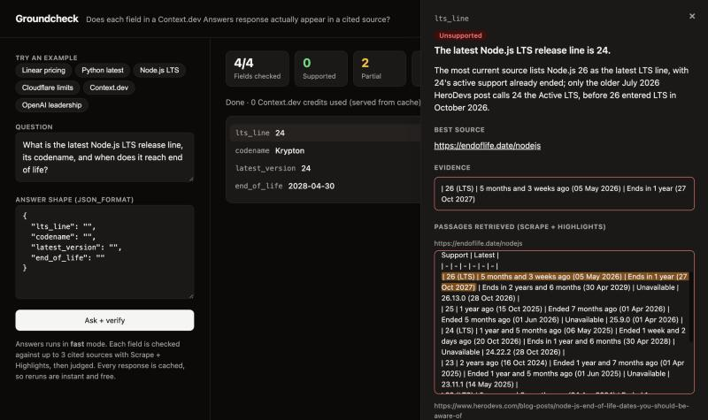

# Groundcheck

Per-field source verification for the [Context.dev](https://context.dev) Answers API.

At Cal Hacks 13.0 my team built [Auditor](https://github.com/Christopher4113/Auditor), an AI staff accountant. A Claude agent proposes journal entries with citations, and a rules engine decides what gets posted. The biggest lesson was that agents cite things they never actually read, so every citation had to be checked against what was really retrieved. When I used Context.dev's Answers API to fill Auditor with real data, I got facts plus a flat list of source URLs. I still had to check by hand which source supported which field. Groundcheck automates that check.

For every field in an Answers response, it answers one question: **does a cited source actually support this value, and where?**



## How it works

```
question + json_format
        │
  1. Ask ──────────── Context.dev Answers (fast mode) → json_content + sources[]
        │
  2. Flatten ──────── json_content → one leaf per field (nulls skipped)
        │             → one standalone claim per field ("Linear's Business plan costs $16 per user per month.")
        │
  3. Gather evidence ─ rank sources (the entity's own site first, profiles/social last), then for each
        │             claim × top 3 sources: Scrape + Highlights with the claim as the query.
        │             If the claim isn't supported, try the next 3 sources for that claim only.
        │
  4. Judge ────────── LLM sees claim + passages → verdict, best source, verbatim quote, reason
        │             quote is checked in code against the retrieved passages; if it isn't there,
        │             supported/partial is downgraded to unsupported
        ▼
  per-field citation map + summary
```

- **Verdicts:** `supported`, `partial`, `unsupported`, `no_evidence`.
- **The verbatim check** ([src/judge.ts](src/judge.ts) `enforceQuote`) is the Auditor lesson in code. The judge must quote a span from a passage that was actually retrieved. Before matching, whitespace, curly quotes, dashes, and Markdown syntax are normalized. Words, numbers, and case are not. If the quote can't be found, a positive verdict is downgraded and marked `quote_verified: false`. If it is found, the source is re-pointed to the page the quote actually came from.
- **Pluggable judge:** Claude (`claude-opus-5-5`, effort `medium`) is the default. Set `JUDGE_MODEL` to swap the judge, for example `claude-haiku-5-5`. Set `JUDGE_PROVIDER=openai` with `JUDGE_BASE_URL`, `JUDGE_MODEL`, and optionally `JUDGE_API_KEY` to use any OpenAI-compatible endpoint, such as a small fine-tuned judge. Claims are phrased once per answer by `CLAIM_MODEL` (Opus by default). Swapping only the judge keeps the claims, and so every cached Highlights query, unchanged: re-judging the whole benchmark costs 0 Context.dev credits.
- **Cost controls:** fast mode only, at most 3 sources per claim, and every Context.dev and LLM response cached under `.cache/`, so reruns cost 0 credits. Credits are read from the `X-Credits-Used` header, and each run hard-stops at a budget (`--budget`, default 200 per CLI run).

## Run it

Requires Node 20.12+ and pnpm.

```bash
pnpm install
cp .env.example .env   # add CONTEXT_DEV_API_KEY and ANTHROPIC_API_KEY
```

> **No keys?** The repo ships its `.cache/` (1.9 MB of recorded Context.dev and judge responses), so `pnpm web` and the CLI replay all 25 benchmark questions, including every example chip in the demo, with no keys and no credits. Anything new needs keys.

**Web demo.** Ask a question in plain English. Groundcheck drafts the answer fields itself, so there's no schema to write. You can customize the fields under *Customize answer fields*. The answer reads as plain sentences, one per fact, each underlined in its verdict color. Click a sentence to see its source and the highlighted evidence passage. *Fields* shows the structured JSON, and *verify: true response* shows the pitched API shape. Facts Answers couldn't find are shown as *Not found* instead of being left out. If a name in the question matches several different companies' sites among the sources ("savvy" → savvy.com, savvywealth.com, getsavvy.com), a notice offers one-click re-asks pinned to each site. Below the answer, **Links Answers researched** lists every URL Answers returned, with what became of it: *Verified* (it backs these fields), *Partial*, *Backs nothing* (read, but no value appears in it), *Unreadable* (blocked or failed), or *Not checked* (beyond the 3 sources checked per field). The "verify: true response" tab shows the response shape pitched below.

```bash
pnpm web               # http://localhost:3000
```

**CLI.** Prints a colored per-field table and writes the JSON result.

```bash
pnpm groundcheck "What are the pricing plans for Linear (linear.app)?" --schema examples/linear-pricing.json
```

`--schema` is optional. Without it, the answer shape is drafted from the question. The CLI also prints the per-link source report.

**Benchmark.** Runs the 25 questions in [bench/questions.json](bench/questions.json) and writes [results/benchmark.json](results/benchmark.json).

```bash
pnpm bench --budget=1500
# re-judge the cached benchmark with another judge (0 Context.dev credits; --budget=0 forbids new calls)
JUDGE_MODEL=claude-haiku-5-5 pnpm bench --budget=0 --out=results/benchmark-haiku.json
```

**Tests.** These run offline against recorded fixtures in [fixtures/](fixtures/): the flattener, the verbatim-quote validator, verdict downgrading, and the full pipeline with mocked APIs. [test/real-quotes.test.ts](test/real-quotes.test.ts) also replays the verbatim check against the 112 real quotes and passages from the benchmark, and checks that a one-digit or one-word change to any of them is caught.

```bash
pnpm test
```

Library use:

```ts
import { groundcheck } from "./src/groundcheck.ts";
const result = await groundcheck("Who is the CEO of Anthropic?", { ceo: "" });
result.citations["ceo"]; // { verdict, source, evidence, reason, claim, passages, ... }
```

## Benchmark results

25 questions in `fast` mode → 140 fields, each checked against up to 3 cited sources. 553 credits. Full write-up and example failures: **[FINDINGS.md](FINDINGS.md)**.

| Category | Fields | Supported | Partial | Unsupported | No evidence |
| --- | ---: | ---: | ---: | ---: | ---: |
| Pricing | 52 | 88.5% | 5.8% | 5.8% | 0% |
| Product features | 31 | 74.2% | 16.1% | 9.7% | 0% |
| Company facts | 26 | 50.0% | 11.5% | 15.4% | 23.1% |
| Dates / numbers | 14 | 42.9% | 21.4% | 35.7% | 0% |
| People / roles | 17 | 41.2% | 0% | 0% | 58.8% |
| **All** | **140** | **67.9%** | **10.0%** | **10.7%** | **11.4%** |

Main takeaways:
- Questions answered from one first-party page ground very well.
- Company and people questions mostly cite LinkedIn and X profile records, which can't be scraped or don't contain the field.
- In two time-sensitive cases (Python, Node.js LTS), the answer is contradicted by a source it cites.
- Checking the entity's own site first, then 3 more sources only for facts the first 3 don't support, raises overall support from 67.9% to 75.7%: people/roles from 41.2% to 76.5%, and company facts from 50.0% to 69.2%. The extra checks cost about 15% more scrapes. See [FINDINGS.md](FINDINGS.md#follow-up-checking-the-right-links-first).

## Deploy

The demo is one long-running Node server (`pnpm start`) that streams results and reads its `.cache/`. Any host that runs a Node web service works without code changes, and it reads `PORT` from the environment.

1. On [Render](https://render.com), choose **New → Web Service** and connect this GitHub repo. On [Railway](https://railway.com), choose **New Project → Deploy from GitHub repo** instead. Both work the same way here.
2. Set the build command to `pnpm install --frozen-lockfile` and the start command to `pnpm start`. Railway detects both on its own.
3. Add these environment variables:
   - `CONTEXT_DEV_API_KEY`
   - `ANTHROPIC_API_KEY`
   - **`DEMO_PASSCODE`**: always set this on a public URL. Without it, anyone could run questions on your keys. With it, visitors can replay the cached example questions for free and instantly, and new questions ask for the passcode.
4. Deploy, then open the URL and click an example.

Render's free tier sleeps after about 15 minutes idle, so the first visit takes about a minute to wake. Railway, or a paid Render instance, stays up. Vercel would need the server rewritten as a serverless function, with the cache bundled in and writes moved to `/tmp`.

## How this could ship inside Answers

Answers already has what it needs. The research agent has read the pages, so the citation map could be produced during research instead of reconstructed afterwards, as Groundcheck has to do. A `verify: true` option could return:

```json
{
  "json_content": { "company": "Linear", "plans": [{ "name": "Business", "price_per_user_monthly": "$16" }] },
  "sources": ["https://linear.app/pricing"],
  "citations": {
    "plans[0].price_per_user_monthly": {
      "verdict": "supported",
      "source": "https://linear.app/pricing",
      "evidence": "$16 per user/month",
      "reason": "The pricing page lists the Business plan at $16 per user/month, billed yearly."
    }
  },
  "sources": [
    { "url": "https://linear.app/pricing", "status": "verified", "supports": ["plans[0].price_per_user_monthly"] }
  ],
  "summary": { "fields": 2, "supported": 2, "partial": 0, "unsupported": 0, "no_evidence": 0 }
}
```

Field paths use the same dotted/indexed form as Groundcheck's flattener, so a client can join `citations` to `json_content` without guessing. The cheapest version would only attach the passage the agent already used for each field. A stricter version would re-check each field the way Groundcheck does: one Highlights query per claim, plus a verbatim check on the quote.

## Layout

```
src/flatten.ts      json_content → leaf fields + labels
src/context.ts      Answers + Scrape/Highlights via the context.dev SDK, disk cache, credit budget
src/judge.ts        claim phrasing, LLM judge (Claude or OpenAI-compatible), zod validation, verbatim check
src/groundcheck.ts  the pipeline
src/cli.ts          CLI (commander + picocolors)
src/server.ts       demo server (node:http, streams NDJSON events)
web/index.html      demo page (no build step)
src/bench.ts        benchmark runner
```
